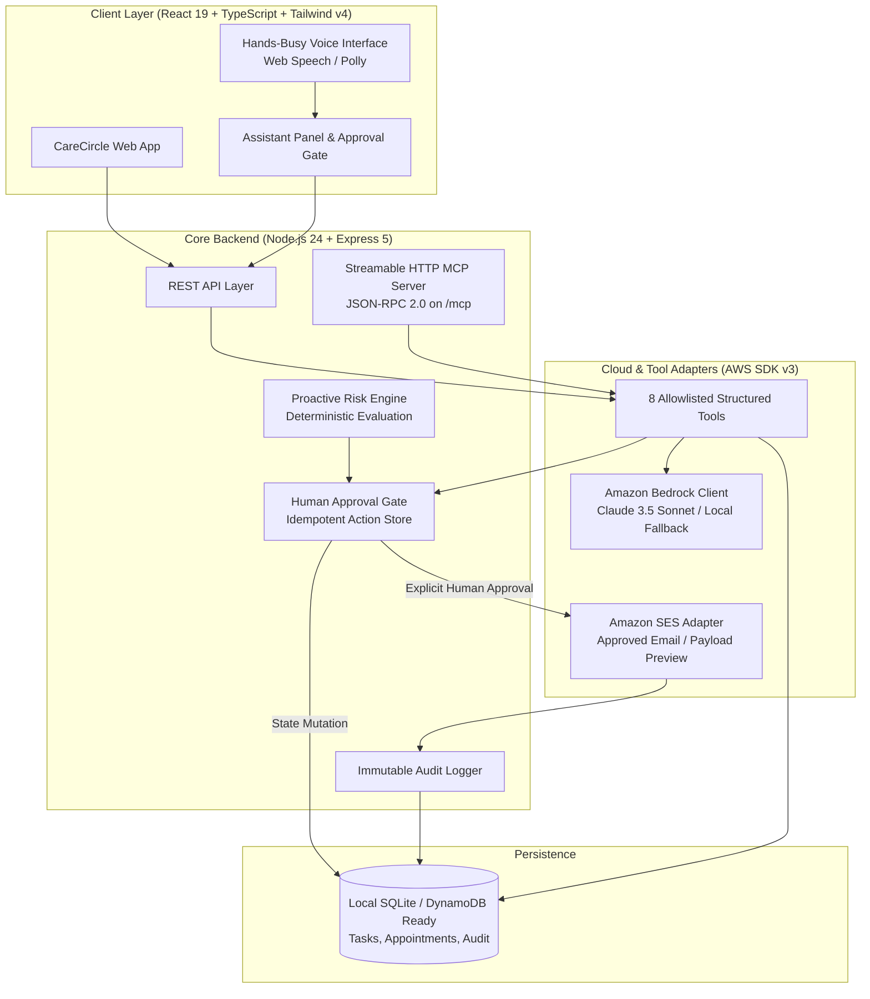

# CareCircle AI 🌿

> **"The family-care assistant that spots what might be missed, asks before it acts, and shows exactly what it did."**

[](https://developer.amazon.com/)
[](https://modelcontextprotocol.io/)
[](https://aws.amazon.com/)

---

### 🌐 Live Public Deployment
- **Frontend Web Application (Vercel):** [https://client-psi-kohl-70.vercel.app](https://client-psi-kohl-70.vercel.app)
- **Backend Web Service (Render):** [https://carecircle-backend-zzof.onrender.com](https://carecircle-backend-zzof.onrender.com)
- **API Health Endpoint:** [https://client-psi-kohl-70.vercel.app/api/health](https://client-psi-kohl-70.vercel.app/api/health)
- **Streamable MCP Server Endpoint:** `POST https://client-psi-kohl-70.vercel.app/mcp`

---

## 1. Product Vision & Mission

Family caregiving for an aging relative is often fragmented across phone calls, notes, messaging apps, and memory. This fragmentation leads to missed appointments, forgotten medication refills, and confusion over who owns critical tasks.

**CareCircle AI** brings appointments, care tasks, caregiver responsibilities, and follow-ups into one coordinated plan for **Meera Rao (Age 78)**. Powered by a conversational agent, structured allowlisted tools, proactive risk detection, and explicit human confirmation gates, CareCircle AI ensures no essential care task falls through the cracks.

> [!IMPORTANT]
> **Care Coordination, Not Medical Treatment:**  
> CareCircle AI is a logistical care coordination platform. It does **not** provide medical diagnosis, clinical treatment recommendations, or emergency dispatch. All demo data is strictly fictional.

---

## 2. Core Architecture

CareCircle AI implements the **Hybrid AWS Adapter Pattern**, combining a resilient local runtime with native AWS cloud integrations and standard Model Context Protocol endpoints:



---

## 3. The 7 Key Hackathon Enhancements

1. **Amazon SES Verified Action (Enhancement B):** Dispatches genuine reminder emails to caregivers after explicit approval. Includes idempotency tokens and sandbox handling.
2. **Proactive Care Coordination (Enhancement C):** Deterministically spots approaching appointments with unconfirmed transport and proposes caregiver outreach: *"Meera's appointment is approaching, but transport is still unconfirmed. Would you like me to remind Ravi?"*
3. **Streamable HTTP MCP Server (Enhancement D):** Exposes allowlisted tools over JSON-RPC 2.0 at `/mcp` (`tools/list` and `tools/call`).
4. **Hands-Busy Voice Interaction (Enhancement E):** Uses Web Speech API for speech-to-text with visual listening waves and spoken audio playback with mute controls.
5. **Human Approval Gate (FR-6):** Separates proposal from execution. Consequential actions (email dispatch, task reassignment) require user confirmation on dedicated Approval Cards.
6. **Caregiver Usability Protocol (Enhancement F):** Benchmarking script in `docs/CAREGIVER_TEST_SCRIPT.md` comparing manual coordination against CareCircle.
7. **Honest Integration Status:** Transparently labels live vs. simulated modes (e.g. `[Simulated SES Mode]` when AWS credentials are not configured).

---

## 4. End-to-End Demo Script (2–3 Minutes)

Follow this primary narrative: **Detect → Explain → Propose → Obtain Approval → Execute → Verify → Audit**.

1. **Overview (20s):** Open `http://localhost:5173/`. See Meera Rao's care plan, greeting, and "Today at a Glance" metrics.
2. **Proactive Detection (25s):** Notice the top alert banner:
   > *"Meera's Routine clinic appointment is approaching at 11:00 AM, but transport is still unconfirmed. Would you like me to remind Ravi?"*
3. **Voice / Assistant Trigger (20s):** Click **"Review & Send Reminder"** or speak via the microphone: *"Remind Ravi about Meera's transport."*
4. **Tool Execution (20s):** The assistant invokes allowlisted tools (`find_unconfirmed_tasks`, `propose_care_action`). Expand the **"Structured tools executed"** badge to inspect the real underlying data queried.
5. **Human Approval Gate (25s):** The assistant renders an **Approval Card** showing target recipient (`Ravi Rao - ravi.rao@example.com`), appointment context, and exact message text.
6. **Execution (15s):** Click **"Approve & Execute Action"**. The backend dispatches through Amazon SES (or verified simulation mode) and renders the confirmed Message ID.
7. **Audit Proof (20s):** Navigate to the **Activity** tab. Verify the timestamped audit record with action details, idempotency token, and result.

---

## 5. Quickstart & Local Setup

### Prerequisites
- Node.js `v20+` or `v24+`
- npm `10+` or `11+`

### Installation
```bash
# Clone the repository
git clone <repo-url>
cd "CareCircle AI"

# Install dependencies for both tiers
npm --prefix server install
npm --prefix client install
```

### Seeding the Demo Data
```bash
# Populate Meera Rao's care records (appointments, tasks, caregivers)
npm run seed
```

### Running Locally
Open two terminal windows:

```bash
# Terminal 1: Backend Server (runs on http://localhost:3001)
npm run dev:server

# Terminal 2: Frontend Client (runs on http://localhost:5173 with API proxy)
npm run dev:client
```

Open `http://localhost:5173/` in your browser.

---

## 6. Testing Key Endpoints

### 1. Test Streamable HTTP MCP Server
```powershell
# In PowerShell: List all allowlisted CareCircle MCP tools
Invoke-RestMethod -Uri http://localhost:3001/mcp -Method Post -ContentType 'application/json' -Body (@{ jsonrpc = '2.0'; id = '1'; method = 'tools/list' } | ConvertTo-Json) | ConvertTo-Json -Depth 5
```

```powershell
# Call a specific tool via MCP (e.g. get_daily_summary)
Invoke-RestMethod -Uri http://localhost:3001/mcp -Method Post -ContentType 'application/json' -Body (@{ jsonrpc = '2.0'; id = '2'; method = 'tools/call'; params = @{ name = 'get_daily_summary'; arguments = @{} } } | ConvertTo-Json) | ConvertTo-Json -Depth 5
```

### 2. Test Proactive Risk Engine
```powershell
# Manually trigger proactive appointment check
Invoke-RestMethod -Uri http://localhost:3001/api/proactive/check -Method Post | ConvertTo-Json -Depth 4
```

### 3. Verify Health & Environment
```powershell
Invoke-RestMethod -Uri http://localhost:3001/api/health | ConvertTo-Json
```

---

## 7. Environment Variables Configuration

To activate live AWS Bedrock and Amazon SES dispatches, create `server/.env`:

```ini
PORT=3001
CLIENT_URL=http://localhost:5173

# Optional: Live AWS credentials (if omitted, runs in safe Verified Simulation Mode)
AWS_REGION=us-east-1
AWS_ACCESS_KEY_ID=your_access_key_here
AWS_SECRET_ACCESS_KEY=your_secret_key_here
SES_SENDER_EMAIL=care@carecircle.demo
SES_VERIFIED_RECIPIENT=caregiver@example.com
```

---

## 8. Definition of Done Checklist

- [x] Responsive healthcare SaaS dashboard with Manrope & Inter typography.
- [x] Real SQLite persistence surviving page refresh and restart.
- [x] 8 allowlisted structured tool functions with Zod argument schemas.
- [x] Streamable HTTP MCP Server mounted on `/mcp`.
- [x] Approval Gate preventing model from executing consequential mutations without user approval.
- [x] Amazon SES reminder email workflow with sandbox handling and deduplication.
- [x] Proactive risk detection spotting approaching appointments with unconfirmed transport.
- [x] Hands-busy voice input and spoken audio playback with cancellation controls.
- [x] Immutable audit trail on `/activity` recording actor, action, timestamp, and verified result.
- [x] Documented caregiver usability study protocol (`docs/CAREGIVER_TEST_SCRIPT.md`).
